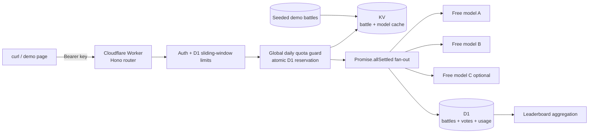
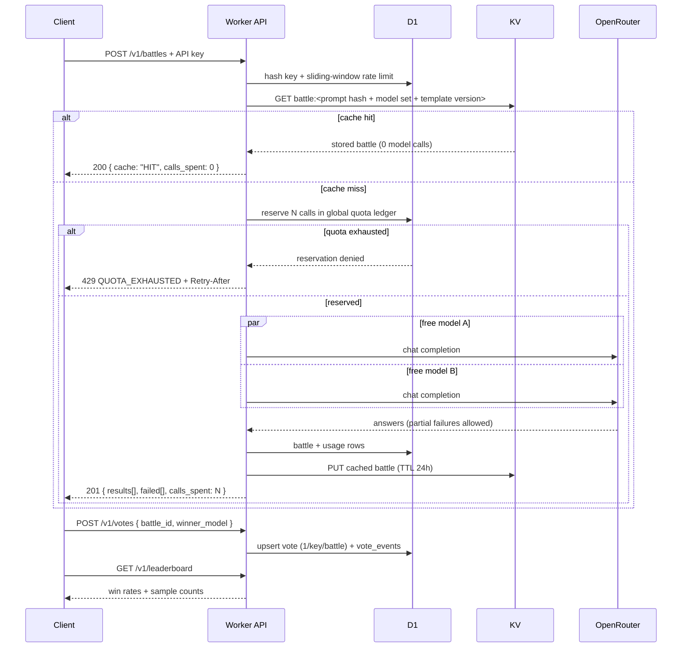

# Model Arena API

A zero-cost, backend-first portfolio project: submit one prompt, watch **two free OpenRouter models answer it in parallel**, compare their latency and token usage, vote for the winner, and track win rates on a leaderboard. The fan-out orchestration is the product — the models are interchangeable dependencies.

Built with **TypeScript + Hono on Cloudflare Workers**, **D1** for keys/battles/votes/usage/quota, and **KV** for battle + model-list caching. No Vectorize, no paid tiers.

> Narrative: *"I built a cost-aware evaluation platform for LLMs."* This differs from the LLM Gateway (#1): the Gateway chooses one working model with fallback; the Arena runs several and lets humans judge.

**Status:** code complete, 19 tests passing. Deployment pending — fill in the D1/KV IDs in `wrangler.toml` (see Setup).

---

## What it does

```bash
BASE=https://model-arena-api.bhalder.workers.dev

# 1. Zero-quota demo: seed fixtures, then ask a pre-baked battle
curl -s -X POST "$BASE/admin/seed" -H 'x-admin-token: <ADMIN_TOKEN>'
curl -s "$BASE/v1/demo/examples"
curl -s -X POST "$BASE/v1/demo/battles" \
  -H 'content-type: application/json' -d '{"example_id":"cdn"}'

# 2. Issue a key for live battles
curl -s -X POST "$BASE/admin/keys" \
  -H 'x-admin-token: <ADMIN_TOKEN>' -H 'content-type: application/json' \
  -d '{"label":"demo"}'
# → {"key":"mak_ab12cd34...","note":"Store this key now — only its SHA-256 hash is retained."}

# 3. Run a live battle — fans out to 2 free models
curl -s -X POST "$BASE/v1/battles" \
  -H 'Authorization: Bearer mak_ab12cd34...' -H 'content-type: application/json' \
  -d '{"prompt":"Explain a CDN in two sentences."}'
```

Sample response:

```json
{
  "id": "bat_01j...",
  "prompt": "Explain a CDN in two sentences.",
  "template": "concise-v1",
  "model_set": ["nvidia/nemotron-3.5-lightning:free", "inclusionai/ling-3.2-flash:free"],
  "results": [
    {
      "model": "nvidia/nemotron-3.5-lightning:free",
      "status": "ok",
      "text": "A CDN is a distributed network of edge servers that caches content close to users…",
      "latency_ms": 812,
      "tokens_in": 24,
      "tokens_out": 52,
      "chars": 204
    }
  ],
  "failed": [],
  "cache": "MISS",
  "calls_spent": 2,
  "created_at": "2026-11-23T10:00:00.000Z",
  "api_key_id": "key_01j..."
}
```

Repeat the same prompt → `cache: "HIT"`, `calls_spent: 0`, **zero** OpenRouter calls.

```bash
# 4. Vote, then read the leaderboard
curl -s -X POST "$BASE/v1/votes" \
  -H 'Authorization: Bearer mak_ab12cd34...' -H 'content-type: application/json' \
  -d '{"battle_id":"bat_01j...","winner_model":"nvidia/nemotron-3.5-lightning:free"}'

curl -s "$BASE/v1/leaderboard?min_votes=1" -H 'Authorization: Bearer mak_ab12cd34...'
# → {"items":[{"model":"…","wins":1,"losses":0,"win_rate":1,"samples":1,…}],"min_votes":1}
```

---

## Architecture





---

## Design decisions (locked)

| Decision | Choice | Reason |
|---|---|---|
| Models per battle | 2 default, 3 supported | ~25 unique battles/day instead of ~16 at 50 req/day |
| Fan-out | `Promise.allSettled`, no model retries | Partial failure returns surviving answers; retries burn quota |
| Cache key | prompt hash + sorted model set + template version | Roster/template changes can't serve stale comparisons |
| Validation | zod validates the **provider envelope**, not model JSON | Text answers need no structured-output support from free models |
| Quota | Global atomic daily ledger **plus** per-key sliding windows | The 50/day budget is shared across all keys |
| Vote policy | One per key per battle, changeable, with `vote_events` history | Correct but forgiving |
| Model choice | User-supplied ids checked against live free list; server roster as default | Flexible and quota-safe |
| Streaming | Deferred | SSE conflicts with cache writes and fan-out |
| Demo | Seeded KV battles + static page, 0 model calls | Every demo interaction is free |

---

## Endpoints

| Method | Path | Auth | Purpose |
|---|---|---|---|
| GET | `/health` | none | Liveness |
| POST | `/v1/battles` | API key | Fan out a prompt, return answers + stats |
| GET | `/v1/battles` | API key | List recent battles |
| GET | `/v1/battles/quota` | API key | Global daily quota status |
| GET | `/v1/battles/:id` | API key | Stored battle + vote count |
| POST | `/v1/votes` | API key | Vote for a model in a battle |
| GET | `/v1/leaderboard` | API key | Win rates, avg latency/tokens, sample counts |
| GET | `/v1/models` | API key | Current free models + source (`live`/`kv`/`seed`) |
| GET | `/v1/usage` · `/v1/usage/events` | API key | Usage aggregates and events |
| GET | `/v1/demo/examples` · POST `/v1/demo/battles` | none | Seeded zero-quota demo |
| POST / GET | `/admin/keys` · `/admin/seed` | admin token | Issue keys, seed demo fixtures |

Machine-readable spec: [`openapi.yaml`](./openapi.yaml).

Errors use `{ error: { code, message, retryable, details? } }` with `Retry-After` on 429 and `WWW-Authenticate` on 401. Codes: `VALIDATION_ERROR`, `UNAUTHORIZED`, `RATE_LIMITED`, `QUOTA_EXHAUSTED`, `UPSTREAM_ERROR`, `MODEL_NOT_FREE`, `NOT_FOUND`, `INTERNAL`.

---

## Setup

```bash
npm install
cp .dev.vars.example .dev.vars      # OPENROUTER_API_KEY + ADMIN_TOKEN

npx wrangler d1 create model-arena-db
npx wrangler kv namespace create CACHE
# paste the IDs into wrangler.toml

npx wrangler d1 migrations apply model-arena-db --local
npx wrangler secret put OPENROUTER_API_KEY
npx wrangler secret put ADMIN_TOKEN
npm run dev        # http://localhost:8787

# deploy
npx wrangler d1 migrations apply model-arena-db --remote
npm run deploy
curl -s -X POST https://<your-worker>/admin/seed -H 'x-admin-token: <ADMIN_TOKEN>'
```

Model roster: `DEFAULT_MODELS` in `wrangler.toml` is the seed fallback. At runtime `/v1/models` discovers current `:free` models from OpenRouter and caches them for 1h. Re-check https://openrouter.ai/models?max_price=0 before deployment.

---

## How I stayed within 50 req/day

- **2 models/battle by default** → ~25 unique battles/day (3 models → ~16).
- Battle cache keyed by normalized prompt + sorted model set + template version → repeats cost 0 calls.
- Global daily quota ledger reserves the full fan-out cost *before* any network call; seeded/cached battles never reach it.
- Per-key sliding-window limiter charges 1 unit per model call, so the 20 RPM cap stays honest.
- Seeded demo battles + fully mocked tests → 0 model calls for demos and CI.
- `usage` and `quota_daily` tables make the exact spend auditable via `GET /v1/usage` and `GET /v1/battles/quota`.

---

## Tests

```bash
npm run typecheck
npm test
```

19 tests across 8 files. All OpenRouter calls are mocked; the in-memory D1/KV doubles are tagged so no external service is touched. Coverage includes partial fan-out failure, cache-key stability, quota exhaustion, vote uniqueness, leaderboard math, and the seeded demo flow.

---

## Project structure

```
src/
  index.ts                    Hono app + routes + error handler
  middleware/{auth,adminOnly}.ts
  routes/{battles,votes,leaderboard,models,usage,demo,admin}.ts
  services/{arena,llm,models,cache,quota,rateLimit,leaderboard}.ts
  db/queries.ts               tagged D1 statements
  lib/{errors,hash,ids,validate}.ts
seed/demo-battles.json        zero-quota demo fixtures
test/{unit,integration,helpers}/
migrations/0001_init.sql
demo/index.html               static GitHub Pages demo
```

Full implementation plan: `C:\Users\BiswajitPC\.opencode\plan\model-arena-api-plan.md`.
